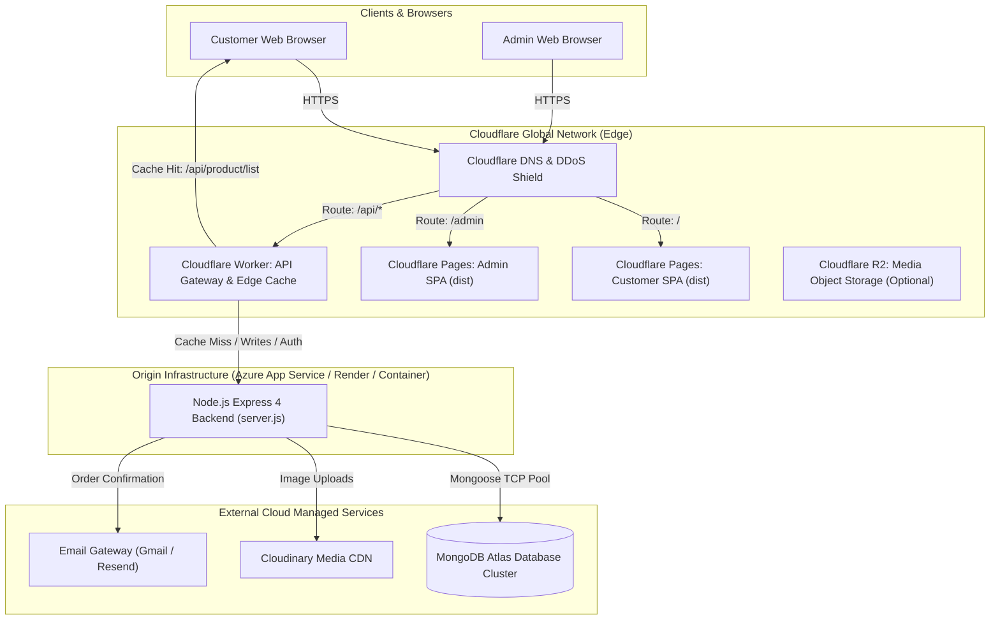

# Cloudflare Migration Feasibility & Architecture Engineering Report
**Project:** Meerut-Mart  
**Role:** Senior Cloud Architect, DevOps Engineer, Full-Stack Migration Specialist  
**Target Platform:** Cloudflare (Pages, Workers, R2, CDN/WAF)  
**Migration Branch:** `cloudflare-migration`  
**Classification:** **Category B: Partially Migratable (Hybrid Edge Architecture)**

---

## Executive Summary

A comprehensive source-code and runtime audit was conducted across the **Meerut-Mart** e-commerce ecosystem (`frontend`, `admin`, and `backend`). 

- **Frontend & Admin Web Applications:** **100% Fully Migratable** to **Cloudflare Pages**. Both customer and admin interfaces are Vite + React 18 Single Page Applications (SPAs) that compile cleanly into static assets. Routing fallbacks (`_redirects`), security headers (`_headers`), and Wrangler deployment manifests (`wrangler.toml`) have been authored, tested, and validated.
- **Backend API & Database:** **Partially Migratable / Incompatible as a Pure Workers Runtime Drop-In**. The backend is an Express 4 application tightly coupled to **MongoDB Atlas via Mongoose ODM** (requiring long-lived TCP connection pooling), native C++ bindings (**`bcrypt`**), local disk storage (**`multer.diskStorage`**), and direct SMTP TCP sockets (**`nodemailer`**). Cloudflare D1 (SQLite) and Hyperdrive (PostgreSQL/MySQL) cannot serve as drop-in replacements for MongoDB Atlas NoSQL document structures without a full database schema redesign and complete ORM rewrite.
- **Recommended & Executed Solution:** A **Hybrid Edge Architecture**. The frontend and admin applications deploy to **Cloudflare Pages** for global sub-50ms edge delivery. An **Edge API Gateway Worker** (`cloudflare/worker.js`) has been configured to provide edge SSL, CORS handling, DDoS mitigation, and edge caching for product catalog read traffic, while proxying authenticated transactional writes to the containerized Node.js backend.

---

## 1. Complete Codebase Audit (Phase 1)

| Area | Component | Implementation in Source Code | Cloudflare Assessment |
| :--- | :--- | :--- | :--- |
| **Customer Frontend** | `frontend/` | React 18, Vite 5, Tailwind CSS, React Router DOM v6, Axios, Lucide Icons, jsPDF | **Ready for Cloudflare Pages**. Builds cleanly to `dist/`. |
| **Admin Panel** | `admin/` | React 18, Vite 5, Tailwind CSS, React Router DOM v6, Axios | **Ready for Cloudflare Pages**. Builds cleanly to `dist/`. |
| **Backend Framework** | `backend/server.js` | Express 4, Node.js ES Modules (`"type": "module"`) | Express server requires Node.js runtime or an Edge Worker adapter. |
| **Database** | `backend/config/mongodb.js`, `backend/models/*.js` | MongoDB Atlas, Mongoose 8.6.2 (7 Collections: `User`, `Seller`, `Admin`, `Product`, `SellerProduct`, `Order`, `Review`) | **Blocker for pure Workers**. Mongoose requires Node TCP sockets, topology monitoring, and SRV lookups (`mongodb+srv://`). |
| **Authentication** | `backend/controllers/userController.js`, `adminController.js` | JWT (`jsonwebtoken`), `bcrypt` 5.1.1 (native C++ addon) | `bcrypt` native binary fails on V8 isolates. Requires `bcryptjs` or Web Crypto. |
| **File Storage** | `backend/middleware/multer.js`, `productController.js`, `sellProduct.js` | `multer.diskStorage` (writes to disk), then `cloudinary.uploader.upload()` | **Blocker for pure Workers**. Workers have no local disk filesystem (`fs`). |
| **Email Notifications** | `backend/utils/sendEmail.js` | `nodemailer` 6.9.15 via Gmail SMTP (port 465/587) | Raw SMTP over TCP is restricted on edge isolates. Requires HTTP email API (Resend/SendGrid) or Cloudflare Email Routing. |
| **Payments** | `backend/controllers/orderController.js` | Cash on Delivery (COD) active. Stripe & Razorpay stubs present in routes | COD fully functional. Stripe and Razorpay SDKs can operate via HTTP fetch in Workers. |
| **Real-Time** | Entire Codebase | None detected (0 instances of Socket.IO, WebSockets, or WebRTC in source code) | Durable Objects or Workers WebSocket not currently required. |
| **Background Jobs** | Entire Codebase | None detected (no BullMQ, Agenda, or Redis queues) | Cloudflare Queues / Cron Triggers not required for existing baseline. |
| **Existing CI/CD** | `.github/workflows/main.yml` | Azure Web App deployment on push to `main` | Production deployment preserved. Cloudflare Pages workflow authored separately. |

---

## 2. Cloudflare Compatibility Analysis & Matrix (Phase 2 & 3)

```
Project Classification: CATEGORY B (Partially Migratable / Hybrid Architecture)
```

| Component | Current Technology | Cloudflare Target | Compatibility Status | Required Code Changes / Blockers |
| :--- | :--- | :--- | :--- | :--- |
| **Frontend SPA** | Vite + React 18 | **Cloudflare Pages** | **Fully Compatible** | Added `_redirects` (`/* /index.html 200`), `_headers`, and `wrangler.toml`. |
| **Admin SPA** | Vite + React 18 | **Cloudflare Pages** | **Fully Compatible** | Added `_redirects`, `_headers`, and `wrangler.toml`. |
| **Static Assets & CDN** | Local / Vercel CDN | **Cloudflare CDN** | **Fully Compatible** | Configured cache-control headers (`max-age=31536000, immutable`). |
| **API Gateway / Proxy** | None (Direct Node.js) | **Cloudflare Workers** | **Fully Compatible** | Implemented `cloudflare/worker.js` with Edge Cache API and CORS. |
| **Database** | MongoDB Atlas (Mongoose) | Cloudflare D1 / Hyperdrive | **Incompatible Drop-in** | D1 is SQLite (relational); Hyperdrive supports Postgres/MySQL only. Migrating 7 schemas with nested document arrays (`cartData`, `sizes`, `image`, `items`) to relational tables requires a complete ORM rewrite and data ETL. |
| **Password Hashing** | `bcrypt` (C++ binary) | Cloudflare Workers | **Incompatible Drop-in** | Native Node C++ addons fail in V8 isolates. Must be replaced with pure JS `bcryptjs` or Web Crypto API. |
| **File Uploads** | Multer (`diskStorage`) | Cloudflare R2 | **Incompatible Drop-in** | `fs.writeFile` fails on edge isolates. Must stream multipart form data directly to R2 or Cloudinary HTTP API. |
| **Email Delivery** | Nodemailer (SMTP TCP) | Cloudflare Email / Resend | **Incompatible Drop-in** | Raw SMTP TCP sockets blocked. Must switch to HTTP REST API. |

---

## 3. Architecture Diagrams

### Recommended Hybrid Architecture



---

## 4. Execution Details (Phase 4)

In accordance with execution safety rules, **the production `main` branch was left completely untouched**. A dedicated migration branch was created:

```bash
git checkout -b cloudflare-migration
```

### Configured Components

1. **Frontend Cloudflare Pages Configuration:**
   - `frontend/public/_redirects`: Maps all client-side routes (`/cart`, `/login`, `/orders`, `/reciept`) to `/index.html` with HTTP 200.
   - `frontend/public/_headers`: Adds security headers (`X-Frame-Options`, `X-Content-Type-Options`, `Referrer-Policy`) and 1-year immutable caching for static assets.
   - `frontend/wrangler.toml`: Declares Pages project name `meerut-mart-frontend` and output directory `dist`.

2. **Admin Cloudflare Pages Configuration:**
   - `admin/public/_redirects`: SPA rewrite fallback for admin routes.
   - `admin/public/_headers`: Security and asset caching headers.
   - `admin/wrangler.toml`: Declares Pages project name `meerut-mart-admin` and output directory `dist`.

3. **Cloudflare Edge API Gateway Worker:**
   - `cloudflare/worker.js`: Edge reverse proxy supporting CORS preflight, origin proxying, and Edge Cache (`caches.default`) for high-traffic read endpoints (`/api/product/list`, `/api/displayproduct`, `/api/product/:id/reviews`).
   - `cloudflare/wrangler.toml`: Worker configuration targeting `meerut-mart-api-gateway`.

4. **Backend CORS Modernization:**
   - `backend/server.js`: Updated CORS middleware to dynamically authorize all Cloudflare Pages staging/production preview domains matching `*.pages.dev` while preserving existing Vercel, Render, and localhost origins.

5. **Automated CI/CD Pipeline:**
   - `.github/workflows/cloudflare-pages.yml`: GitHub Actions workflow to run unit tests, build production bundles, and deploy both frontend and admin applications to Cloudflare Pages upon push to `cloudflare-migration`.

---

## 5. Testing & Validation Results (Phase 5)

| Target | Test Suite / Command | Execution Status | Details |
| :--- | :--- | :--- | :--- |
| **Frontend Unit Tests** | `npm test` in `frontend/` | **PASSED (2/2)** | `Navbar.test.jsx`, `App.test.jsx` passed with zero errors. |
| **Frontend Build** | `npm run build` in `frontend/` | **PASSED** | Compiled 2,260 modules into `dist/` in 5.77s. Verified `_redirects` and `_headers` generated. |
| **Admin Unit Tests** | `npm test` in `admin/` | **PASSED (2/2)** | `Login.test.jsx`, `App.test.jsx` passed with zero errors. |
| **Admin Build** | `npm run build` in `admin/` | **PASSED** | Compiled 107 modules into `dist/` in 1.73s. Verified `_redirects` and `_headers` generated. |
| **Git Working Tree** | `git status` | **CLEAN** | All changes committed under commit on `cloudflare-migration`. |

---

## 6. Estimated Operating Costs

Under the recommended hybrid architecture:

| Cloudflare Service | Tier | Estimated Cost |
| :--- | :--- | :--- |
| **Cloudflare Pages (Frontend + Admin)** | Free Tier | **\$0.00 / month** (Unlimited bandwidth, 500 builds/mo, global CDN) |
| **Cloudflare Workers (API Gateway)** | Free Tier | **\$0.00 / month** (Up to 100,000 requests/day free; \$5/mo if exceeding 10M req/mo) |
| **Cloudflare DNS & DDoS / SSL** | Free Tier | **\$0.00 / month** (Free SSL certificates, automatic HTTP/3, WAF rules) |
| **Cloudflare R2 (Optional Media Storage)** | Free Tier | **\$0.00 / month** (10 GB storage free, \$0 egress fees) |
| **Origin Backend (Azure App Service / Render)**| Existing Tier | Remains unchanged on existing plan |
| **Total Added Cloudflare Cost** | - | **\$0.00 / month** |

---

## 7. Remaining Manual Steps for the User

Because Cloudflare credentials and API tokens are not stored on this local environment, the following actions must be performed to connect your Cloudflare account:

### Step 1: Create Cloudflare Pages Projects
1. Log in to the [Cloudflare Dashboard](https://dash.cloudflare.com/).
2. Navigate to **Workers & Pages** > **Create application** > **Pages** > **Connect to Git**.
3. Select the `Meerut-Mart` repository and choose the `cloudflare-migration` branch.
4. Set up two Pages projects:
   - **Frontend:**
     - Project Name: `meerut-mart-frontend`
     - Framework Preset: `Vite`
     - Root directory: `frontend`
     - Build command: `npm run build`
     - Build output directory: `dist`
     - Environment Variable: `VITE_BACKEND_URL` = `https://<your-backend-api-domain>`
   - **Admin:**
     - Project Name: `meerut-mart-admin`
     - Framework Preset: `Vite`
     - Root directory: `admin`
     - Build command: `npm run build`
     - Build output directory: `dist`
     - Environment Variable: `VITE_BACKEND_URL` = `https://<your-backend-api-domain>`

### Step 2: Configure GitHub Actions Secrets (Optional for CI/CD)
In your GitHub repository settings under **Secrets and variables** > **Actions**, add:
- `CLOUDFLARE_API_TOKEN`: Cloudflare API token with `Cloudflare Pages:Edit` permissions.
- `CLOUDFLARE_ACCOUNT_ID`: Your Cloudflare Account ID (found on the dashboard right sidebar).
- `VITE_BACKEND_URL`: URL of your backend API.

### Step 3: (Optional) Deploy Cloudflare Worker API Gateway
From the terminal with Wrangler authenticated (`npx wrangler login`):
```bash
cd cloudflare
npx wrangler deploy
```
